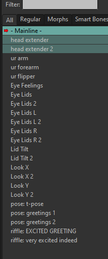
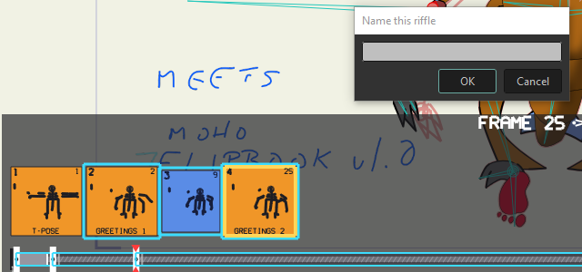
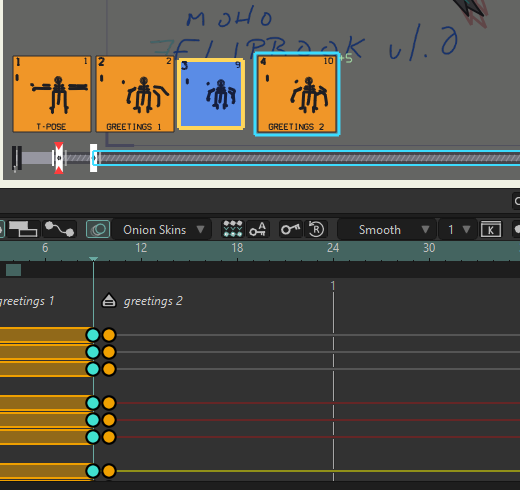
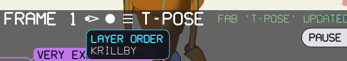
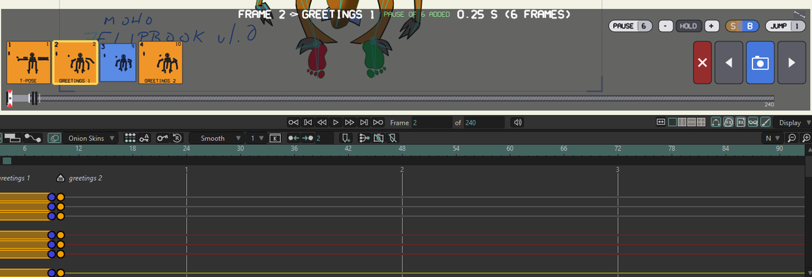
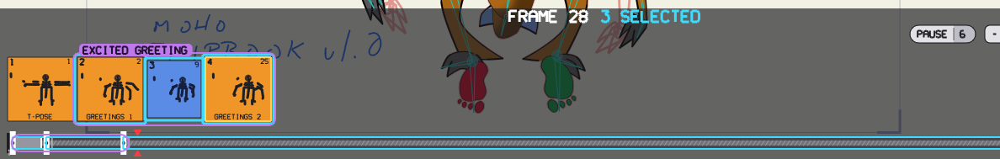
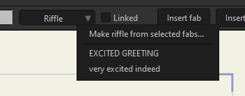
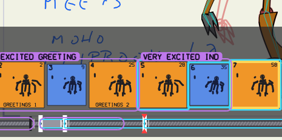
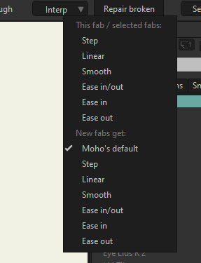

# Moho-Flipbook

> ⚠️ **AI-written code.** This software was created by a human mind, but every line of Flipbook's code was written by Claude (AI), then directed and tested by hand by Doug Craven. Please read [AI-NOTICE.md](AI-NOTICE.md), and back up your files before using it on real work.

A Flipbook add-on for Moho Pro 14 (tested on Moho Pro 14.5, Windows). Capture poses with one click, reuse them anywhere, and build reusable chunks of animation called riffles. It makes your animation more fluid, natural, and fun.

## Meet Cheesoid
Moho Flipbook is made by **Cheesoid**, a team of two:
- **Doug Craven**, who designed it, directed it and tested every feature by hand in Moho.
- **Claude**, an AI model made by Anthropic, who wrote all of the code.

Doug brought the animator's eye. Claude brought the Lua.

## Requirements
- Moho Pro 14 (tested on 14.5) on Windows. Mac is untested.
- A character rigged with a bone layer.

## Installing
Instructions are coming with the first release.

## In a Nutshell

### Most Basic Workflow
1. POSEthe character.
2. CLICK THE CAMERA to record a Pose or Breakdown.
3. REUSE or MODIFY the Pose at any time!
4. Combine Poses into a RIFFLE, a reusable chunk of animation. It's easy! Select more than one Fage and CLICK THE CAMERA.
5. REUSE or MODIFY the Riffle at any time!

### Basic Workflow
1. Pose your character. You can manipulate bones, move vector points, change shape and layer order, and change shape colour to create just the right pose.
2. CLICK THE CAMERA to take a snapshot of the pose. You name the pose as you create it.

   
3. If you named it, your pose is stored in a dropdown menu AND in the Moho Actions tab. Using the Flipbook dropdown, you can drop your pose anywhere on the timeline.

    
4. When you have enough poses to create an action, select several fages and click the camera: that makes a **riffle**, a reusable block of animation. It's saved in its own dropdown and in the Moho Actions tab.

   

### The Fage
**Fage** stands for Flipbook Page: each "page" of the Flipbook, a snapshot of a pose. Fages can be **poses** (saved for later) or **breakdowns** (just for this run). Fages can be grouped together into clumps of action called **riffles** ... more on that below!

You simply and organically change almost anything about your character and CLICK THE CAMERA. That's it. You have a new fage in your Flipbook and a new pose you can reuse or modify.

### The Fimeline
This is the main work area of the Flipbook. You guessed it: **Fimeline** stands for Flipbook Timeline. It's designed to let you do all of your Moho Flipbook work in ONE PLACE, without worrying about its submenu or even the Moho Timeline.

The Fimeline does not replace the Moho Timeline. It's designed to interact with it and enhance it.

The Fimeline has several parts:

<!-- Doug: your labelled Fimeline diagram goes here -->

- Your **fages**, one after another in a Flipbook. You can drag one fage or a selection of fages left and right to change the timing of all the keys associated with them. It supports inserting and deleting fages. It dynamically updates poses or creates new distinct poses from old.

  
- Below that, the **master fimeline** at the bottom is a quick way to manipulate the timing of the fages above it AND has a handy playhead.
- The **info bar** (at the top) gives the most important information: the frame number, which kinds of keys are stored in the selected fage (i.e. bone, vector, layer order, etc.) and how long the current fage is held, in seconds. Rest the pointer on one of its little symbols to see which layers it stands for.

  
- The **tools** (right side): insert a pause, increase or decrease the hold, switch between Pose (P) and Breakdown (B) snapshots, JUMP, delete a fage (the red X), and a navigation bar. All tools are duplicated on the submenu at the top of the screen.

  

### The Riffle (Holy crud, I saved the best for last!)
Not only can you save poses and drop them into the Fimeline, you can save **riffles** (little riffs of animation) and drop them into your work at any time. Paste a riffle as a REFERENCE and it updates everywhere when the riffle changes, or as a COPY you can change on its own.

 

Like poses, you can reuse riffles and create a new riffle from an old one. Change a copy, then make a riffle from it, and Flipbook offers to update the original:

### Many More Cool Things
Working with Claude to create Moho Flipbook, I had it focus on one directive: Flipbook should feel intuitive, easy to understand and fun. However, it's got a lot under the hood, and detail-oriented animators will find a lot of settings that can change the feeling! A few highlights:
- **Interpolation per fage:** set one fage, or a whole selection, to Smooth, Linear, Step and more.
- **Holds and pauses,** measured in frames and seconds.
- **Broken-fage repair:** if keys get deleted by hand, Flipbook flags the fage and can put them back.
- **Fages carry more than bones:** bone flips, fill and line colours, line width and layer visibility.

 

*Some screenshots were taken before fabs were renamed fages and before the S button became P; the labels in them may differ slightly.*
