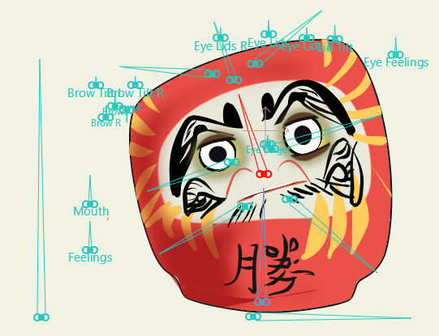
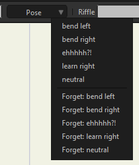
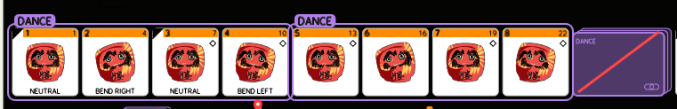
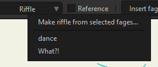
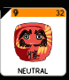
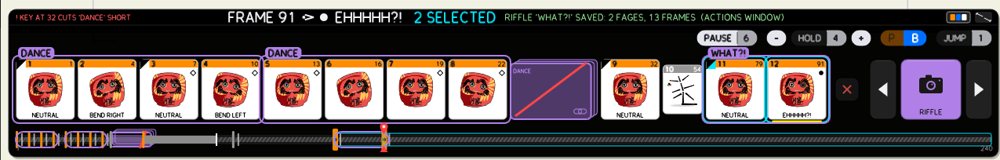
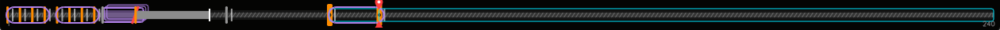
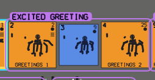

# Moho-Flipbook

> ⚠️ **AI-written code.** This program was created by CHEESOID, a working partnership between a human animator and programmer, Doug Craven, and an unthinking soulless machine...me, Claude Opus 5.5. Ideas were conceived and evaluated by Doug. **Every line of Flipbook's code was written by Claude (AI)**, then directed and tested by hand by Doug Craven. Please read [AI-NOTICE.md](AI-NOTICE.md), and back up your files before using it on real work.

A Flipbook add-on for Moho Pro 14 (tested on Moho Pro 14.5, Windows). Capture almost ANY CHANGE (bones, point, shapes, layer order) into self-contained poses with one click, reuse them anywhere. Build reusable chunks of action called "Riffles." 

## In a Nutshell

###  Basic Workflow
1. POSE the character.

   

2. CLICK THE CAMERA to record a Pose or Breakdown.

   

3. REUSE or MODIFY the Pose at any time!

   

4. Combine Poses into a RIFFLE, a reusable chunk of animation. It's easy! Select more than one Fage and CLICK THE CAMERA.

   

5. REUSE or MODIFY the Riffle at any time!

   

## The Fage
**Fage** stands for Flipbook Page: each "page" of the Flipbook, a snapshot of a pose. Fages can be **poses** (saved for later) or **breakdowns** (just for this run). You can select multiple fages, move them in the timeline, add a pause, insert a fage between two keyframes. Ripple Editing happens magically! The fage windows has tons of info! 

## The Fimeline
This is the main work area of the Flipbook. You guessed it: **Fimeline** stands for Flipbook Timeline. The Fimeline interacts with the Moho timeline. Select a fage, for example, and you select its keys.

The fimeline allows you to:
1. create and delete fages and riffles, adjust timing by sliding fages, add pauses, and much more!
2. use the Timing Bar to make quick adjustments to timing.

   

3. See important information about the selected fage(s).

   

## The Riffle (Holy crud, I saved the best for last!)
Riffling is flipping quickly through pages to see an animation. A riffle in Flipbook is a set of 

## Many More Cool Things
Working with Claude to create Moho Flipbook, I had it focus on one directive: Flipbook should feel intuitive, easy to understand and fun. However, it's got a lot under the hood, and detail-oriented animators will find a lot of settings that can change the feeling! A few highlights:
- **Interpolation per Fage:** set one Fage, or a whole selection, to Smooth, Linear, Step and more.
- **Holds and pauses,** measured in frames and seconds.
- **Broken-Fage repair:** if keys get deleted by hand, Flipbook flags the Fage and can put them back.
- **Fages carry more than bones:** bone flips, fill and line colours, line width and layer visibility.

## Requirements
- Moho Pro 14 (tested on 14.5) on Windows. Mac is untested.
- A character rigged with a bone layer.

## Installing
Unzip the download, then either:
- In Moho, choose **Scripts > Install Script...**, click **Select A Script Folder** and pick the unzipped `chz_moho_flipbook` folder, or
- Copy its `tool` and `ScriptResources` folders into the `scripts` folder of your Custom Content Folder (**File > Open Custom Content Folder**).

Restart Moho. Flipbook appears in the Tools panel.

## Meet Cheesoid

Moho Flipbook is made by **Cheesoid**, a team of two:
- **Doug Craven**, who designed it, directed it and tested every feature by hand in Moho.
- **Claude**, an AI model made by Anthropic, who wrote all of the code.

Doug brought the animator's eye and the human brain and the high standards.  Claude brought the Lua.

## Coming Soon from Cheesoid:
1. Moho Launcher
2. Layer Sequencer
3. Face Maker

